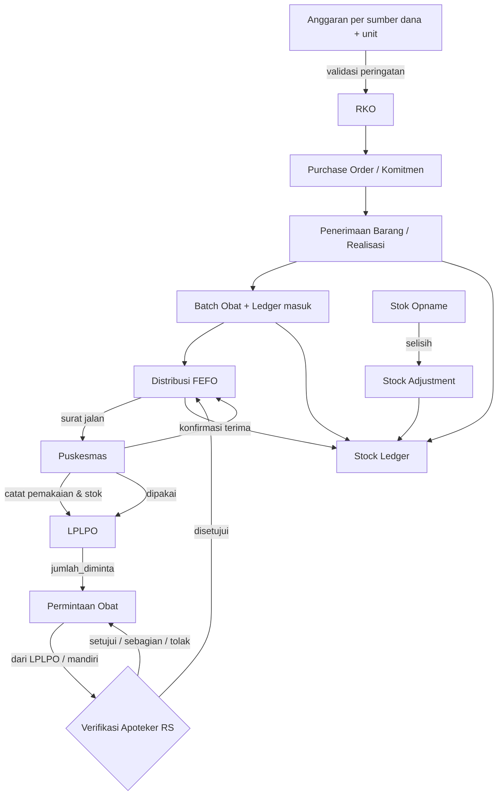

# Blueprint — Aplikasi Manajemen Stok Obat

> **Status:** Draft untuk review\
> **Dibuat:** 19 November 2026\
> **Lokasi proyek:** `D:\project\stok-obat`

* * *

## Daftar Isi

1. [Ringkasan](#1-ringkasan)
2. [Stack Teknologi](#2-stack-teknologi)
3. [Prinsip Arsitektur](#3-prinsip-arsitektur)
4. [Alur Domain End-to-End](#4-alur-domain-end-to-end)
5. [Model Data](#5-model-data)
6. [Enum](#6-enum)
7. [Action Classes](#7-action-classes)
8. [State Machine](#8-state-machine)
9. [Rumus & Perhitungan](#9-rumus--perhitungan)
10. [Otorisasi (RBAC)](#10-otorisasi-rbac)
11. [Laporan & Dashboard](#11-laporan--dashboard)
12. [Event & Notifikasi](#12-event--notifikasi)
13. [Struktur Folder](#13-struktur-folder)
14. [Strategi Testing](#14-strategi-testing)
15. [Roadmap Implementasi](#15-roadmap-implementasi)
16. [Catatan Implementasi Penting](#16-catatan-implementasi-penting)
17. [API Layer (REST)](#17-api-layer-rest)
18. [Prediksi Kebutuhan Obat (AI)](#18-prediksi-kebutuhan-obat-ai)

* * *

## 1. Ringkasan

### 1.1 Konteks

Aplikasi ini mengelola **gudang farmasi pusat di rumah sakit** dan **distribusi obat ke
puskesmas**. Bukan aplikasi retail/POS, bukan pula sistem rekam medis.
Fokus utama adalah akurasi stok, ketertelusuran batch, kepatuhan regulasi farmasi
(CDOB), dan pengelolaan anggaran pengadaan.

### 1.2 Keputusan Desain (Terkunci)

| No | Keputusan                 | Pilihan                                                                |
|----|---------------------------|------------------------------------------------------------------------|
| 1  | Stack                     | Laravel + Livewire 3 + Tailwind + Alpine                               |
| 2  | Domain                    | RS (gudang pusat) → distribusi ke puskesmas                            |
| 3  | Skala                     | Satu gudang pusat, multi-user + role                                   |
| 4  | Stok                      | Batch + expiry, stok minimum, ledger append-only                       |
| 5  | Pembelian                 | PO → penerimaan → supplier                                             |
| 6  | Distribusi                | Berbasis permintaan puskesmas, FEFO                                    |
| 7  | Perencanaan               | LPLPO + Permintaan Obat + RKO (metode historis)                        |
| 8  | Akses puskesmas           | Akun login dengan scoping per `facility_id`                            |
| 9  | Hubungan LPLPO/permintaan | Keduanya didukung (dari LPLPO **atau** mandiri)                        |
| 10 | Sumber dana               | APBN, APBD, BOK, DAK, BPJS, hibah, swadaya, retribusi, lain            |
| 11 | Realisasi anggaran        | Diakui **saat penerimaan barang**                                      |
| 12 | Pagu                      | Tahunan + sumber dana + unit (RS & tiap puskesmas)                     |
| 13 | Validasi pagu             | **Peringatan saja**, dengan `alasan_override_pagu`                     |
| 14 | Stok opname               | Ya, dengan mode buta + snapshot stok sistem                            |
| 15 | Narkotika/psikotropika    | **Tidak masuk scope**                                                  |
| 16 | Integrasi SIMRS           | **Tidak ada**                                                          |
| 17 | Sub-gudang                | **Tidak ada**, cukup field `lokasi_rak`                                |
| 18 | REST API                  | Ya, **semua proses** diekspos via `/api/v1` (Sanctum, semua modul)     |
| 19 | Prediksi AI               | Bertahap: **statistik → ML → LLM narasi**                              |
| 20 | Infrastruktur prediksi    | **PHP dulu → FastAPI Cloud (Hobby)**; tanpa Python/Docker di server RS |
| 21 | Otomatisasi AI            | **Rekomendasi + approval apoteker** (tidak pernah auto-approve)        |
| 22 | Privasi data AI           | **Angka agregat tanpa identitas** boleh dikirim ke cloud eksternal     |

### 1.3 Di Luar Scope

- Penjualan retail / kasir / resep pasien.
- Pelacakan narkotika & psikotropika.
- Integrasi dengan SIMRS / rekam medis.
- Multi-gudang / multi-cabang.
- Pelacakan pembayaran ke supplier (realisasi = penerimaan barang).

* * *

## 2. Stack Teknologi

### 2.1 Stack Utama

| Layer         | Teknologi                                                         |
|---------------|-------------------------------------------------------------------|
| Backend       | Laravel 11/12 (PHP 8.3+)                                          |
| UI            | Livewire 3 + Alpine.js + Tailwind CSS (Volt starter kit opsional) |
| Database      | MySQL 8 / PostgreSQL 15                                           |
| Cache & Queue | Database (default) atau Redis                                     |
| File storage  | Laravel `storage` (lampiran izin, surat jalan, tanda terima)      |
| API auth      | Laravel Sanctum (token mobile + cookie SPA)                       |
| API docs      | Scramble (OpenAPI otomatis)                                       |
| Forecast AI   | Holt-Winters (PHP murni) → FastAPI Cloud Hobby (Tier 2)           |
| LLM opsional  | API LLM untuk narasi penjelas saja (bukan penghitung angka)       |
| API key/HMAC  | Otorisasi Laravel ↔ FastAPI Cloud                                 |

### 2.2 Package

| Kebutuhan                  | Package                                                     |
|----------------------------|-------------------------------------------------------------|
| Role & permission          | `spatie/laravel-permission`                                 |
| Audit trail                | `spatie/laravel-activitylog`                                |
| Export Excel               | `maatwebsite/excel`                                         |
| PDF (surat jalan, laporan) | `barryvdh/laravel-dompdf`                                   |
| Backup                     | `spatie/laravel-backup`                                     |
| Pola Action (opsional)     | `lorisleiva/laravel-actions`                                |
| Autentikasi API            | `laravel/sanctum`                                           |
| Dokumentasi API            | `scramble/scramble` (OpenAPI)                               |
| CORS                       | `config/cors.php` (bawaan Laravel)                          |
| Testing                    | Pest PHP / PHPUnit                                          |
| Bawaan Laravel             | Queue, Scheduler, Notification, Policy, Event, Global Scope |

* * *

## 3. Prinsip Arsitektur

1. **Batch-centric stock** — unit stok terkecil adalah `batch_obat` (obat + no.
   batch + expiry), bukan sekadar jenis obat.
2. **Append-only ledger** — setiap mutasi ditulis sebagai jurnal permanen di
   `stock_ledger`. Stok saat ini adalah turunan ledger, bukan angka yang ditimpa.
3. **Satu jalur mutasi** — semua perubahan stok (penerimaan, distribusi, penyesuaian,
   opname) wajib lewat `stock_ledger`. Opname tidak mengubah stok langsung; ia membuat
   `stock_adjustment` yang lalu diproses ke ledger.
4. **FEFO (First Expired First Out)** — batch dengan expiry terdekat yang keluar lebih
   dulu saat distribusi.
5. **Thin UI, fat domain** — Livewire hanya orchestrasi; logika bisnis ada di Action
   classes agar mudah diuji.
6. **Snapshot untuk dokumen final** — LPLPO, RKO, Anggaran, Opname menyimpan hasil
   hitungan/versi; tidak dihitung ulang atau diedit diam-diam.
7. **Re-authorization di Action layer** — otorisasi tidak hanya disembunyikan di UI,
   tetapi divalidasi ulang di service.
8. **Auditability** — semua perubahan angka & status tercatat di `activity_log` (krusial
   untuk CDOB).
9. **API sebagai adapter, bukan duplikasi logika** — semua proses diekspos lewat REST
   API `/api/v1`, tetapi Controller hanya memanggil Action yang sama dengan Livewire.
   Livewire memanggil Action langsung (tanpa HTTP self-call).
10. **Satu aturan validasi** — FormRequest dipakai bersama oleh Livewire dan API.

* * *

## 4. Alur Domain End-to-End



**Ringkasan siklus:** LPLPO → permintaan → verifikasi → distribusi → pemakaian → LPLPO
berikutnya. Sumber dana melekat dari anggaran → PO → penerimaan → batch → nilai
distribusi.

* * *

## 5. Model Data

### 5.1 Grup A — Identitas & Referensi

**`users`** `id`, `name`, `email`, `password`, `facility_id` (FK `facilities`, nullable
— null = staf RS), `email_verified_at`, `remember_token`, `timestamps`, `softDeletes`

**`facilities`** (puskesmas; RS direpresentasikan dengan `facility_id = null`/`0`) `id`,
`kode`, `nama`, `jenis` (`rs`/`puskesmas`), `alamat`, `kontak`, `aktif`, `timestamps`

**`sumber_dana`** `id`, `kode`, `nama`, `jenis` (enum `JenisSumberDana`),
`kode_rekening`, `program`, `keterangan`, `aktif`, `timestamps`

**Tabel Spatie:** `roles`, `permissions`, `model_has_roles`, `model_has_permissions`,
`role_has_permissions`

**`personal_access_tokens`** (Sanctum — token API untuk klien mobile/SPA) `id`,
`tokenable_type`, `tokenable_id`, `name`, `token` (unique, hashed), `abilities` (JSON),
`last_used_at`, `expires_at`, `created_at`, `updated_at`

### 5.2 Grup B — Master Farmasi

**`obat`** `id`, `kode_obat` (unique), `nama`, `nama_generik`, `kategori_id` (FK),
`bentuk_sediaan` (enum), `kekuatan`, `satuan`, `golongan` (enum:
`bebas`/`bebas_terbatas`/`keras`), `no_izin_edar`, `produsen`, `harga_satuan_terakhir`,
`stok_minimum`, `butuh_cold_chain` (bool), `aktif`, `timestamps`, `softDeletes`

**`kategori_obat`** `id`, `kode`, `nama`, `keterangan`, `timestamps`

**`supplier`** `id`, `kode`, `nama`, `alamat`, `kontak`, `npwp`, `no_izin_usaha`,
`aktif`, `timestamps`

**`licenses`** (izin usaha & izin edar) `id`, `jenis`
(`izin_apotek`/`izin_edar`/`cdob`/`lainnya`), `nomor`, `tanggal_terbit`,
`tanggal_kedaluwarsa`, `file_path`, `keterangan`, `timestamps`

### 5.3 Grup C — Stok

**`batch_obat`** `id`, `obat_id` (FK), `no_batch`, `tanggal_produksi`,
`tanggal_kedaluwarsa`, `jumlah_awal`, `jumlah_sisa`, `harga_beli`, `lokasi_rak` (teks
bebas), `sumber_dana_id` (FK, nullable — snapshot), `supplier_id` (FK, nullable),
`aktif`, `timestamps`\
**Constraint:** `UNIQUE(obat_id, no_batch)`

**`stock_ledger`** *(append-only — tanpa `updated_at`, tanpa hard delete)* `id`,
`batch_id` (FK), `tipe` (`masuk`/`keluar`), `jumlah`, `jumlah_sebelum`,
`jumlah_sesudah`, `tipe_referensi` (`penerimaan`/`distribusi`/`penyesuaian`/`opname`),
`referensi_id`, `tanggal_transaksi`, `user_id`, `catatan`, `created_at`

### 5.4 Grup D — Perencanaan & Permintaan

**`lplpo`** `id`, `no_lplpo`, `facility_id` (FK), `bulan`, `tahun`,
`tanggal_penyerahan`, `status` (enum `StatusLplpo`), `versi`, `verified_by`,
`verified_at`, `catatan`, `timestamps`\
**Constraint:** `UNIQUE(facility_id, bulan, tahun, versi)`

**`lplpo_item`** `id`, `lplpo_id` (FK), `obat_id` (FK), `stok_awal`, `pemasukan`,
`pemakaian`, `stok_akhir` (dilaporkan puskesmas), `stok_akhir_sistem` (dari ledger,
untuk deteksi selisih), `stok_minimum`, `jumlah_diminta`, `keterangan`

**`permintaan_obat`** `id`, `no_permintaan`, `facility_id` (FK), `lplpo_id` (FK,
nullable), `sumber` (enum `SumberPermintaan`), `periode_awal`, `periode_akhir`,
`tanggal`, `status` (enum `StatusPermintaan`), `verified_by`, `verified_at`,
`catatan_verifikasi`, `timestamps`

**`permintaan_obat_item`** `id`, `permintaan_id` (FK), `obat_id` (FK), `jumlah_diminta`,
`jumlah_disetujui`, `status_item`
(`disetujui`/`sebagian`/`backorder`/`ditolak`/`selesai`), `keterangan`

**`rko`** `id`, `no_rko`, `tahun`, `periode` (bulan/TW), `tingkat` (enum `TingkatRko`),
`metode` (enum `MetodeRko`: `historis`/`ai`/`kombinasi`), `lead_time_bulan`,
`faktor_pengaman`, `bobot_ai` (0–1, untuk `kombinasi`), `sumber_dana_id` (FK, nullable —
default), `status` (enum `StatusRko`), `versi`, `disusun_oleh`, `disetujui_oleh`,
`catatan`, `timestamps`

**`rko_item`** `id`, `rko_id` (FK), `obat_id` (FK), `sumber_dana_id` (FK, nullable —
override per item), `pemakaian_rata_rata`, `estimasi_pemakaian`, `stok_akhir`,
`stok_dalam_pesanan`, `stok_pengaman`, `kebutuhan_bersih`, `harga_estimasi`,
`total_estimasi`, `sumber`, `catatan`,\
`prediksi_id` (FK `prediksi_obat`, nullable), `prediksi_ai`, `prediksi_interval_bawah`,
`prediksi_interval_atas`, `prediksi_confidence`, `alasan_pilihan`

**`prediksi_obat`** (audit trail setiap prediksi AI) `id`, `obat_id` (FK), `facility_id`
(FK, nullable = gabungan), `periode_bulan`, `periode_tahun`, `nilai_prediksi`,
`interval_bawah`, `interval_atas`, `confidence_score`, `metode_model` (enum
`MetodePrediksi`), `versi_model`, `tanggal_prediksi`, `data_snapshot` (JSON — input
agregat yang dipakai), `faktor_penjelas` (JSON), `status` (enum `StatusPrediksi`),
`mape`, `evaluated_at`, `timestamps`\
**Constraint:** satu prediksi per
`(obat_id, facility_id, periode_bulan, periode_tahun, metode_model, versi_model)`;
agregasi RKO bersifat **bottom-up** (dijumlahkan dari prediksi per fasilitas).

**`anggaran`** `id`, `sumber_dana_id` (FK), `tahun`, `facility_id` (FK, **sentinel `0` =
RS**), `jumlah_anggaran`, `status`, `versi`, `keterangan`, `timestamps`\
**Constraint:** validasi unik aplikasi `(tahun, sumber_dana_id, facility_id)` — gunakan
sentinel `0` karena MySQL mengizinkan banyak `NULL` pada unique index.

### 5.5 Grup E — Pengadaan

**`purchase_order`** `id`, `no_po`, `supplier_id` (FK), `sumber_dana_id` (FK),
`no_dokumen_anggaran` (nullable), `tanggal_po`, `status`
(`draft`/`dikirim`/`diterima_sebagian`/`diterima`/`dibatalkan`), `total`, `user_id`,
`alasan_override_pagu` (nullable), `approved_by`, `catatan`, `timestamps`

**`purchase_order_item`** `id`, `po_id` (FK), `obat_id` (FK), `jumlah`, `harga_beli`,
`no_batch` (opsional), `tanggal_kedaluwarsa` (opsional), `jumlah_diterima`, `subtotal`

**`goods_receipt`** `id`, `no_penerimaan`, `po_id` (FK), `supplier_id` (FK),
`sumber_dana_id` (FK — snapshot dari PO), `tanggal_terima`, `user_id`, `catatan`,
`timestamps`

**`goods_receipt_item`** `id`, `receipt_id` (FK), `po_item_id` (FK, nullable), `obat_id`
(FK), `no_batch`, `tanggal_produksi`, `tanggal_kedaluwarsa`, `jumlah`, `harga_beli`,
`lokasi_rak`, `sumber_dana_id` (FK — snapshot), `subtotal`

### 5.6 Grup F — Distribusi & Penyesuaian

**`distribution`** `id`, `no_surat`, `facility_id` (FK — puskesmas tujuan),
`permintaan_id` (FK, nullable), `tanggal`, `status`
(`draft`/`disetujui`/`dikirim`/`diterima`/`dibatalkan`), `pengirim_id`, `penerima_nama`,
`tanggal_diterima`, `file_tanda_terima`, `catatan`, `user_id`, `timestamps`

**`distribution_item`** `id`, `distribution_id` (FK), `permintaan_item_id` (FK,
nullable), `obat_id` (FK), `batch_id` (FK), `jumlah`, `harga_satuan` (snapshot),
`subtotal`, `keterangan`

**`stock_adjustment`** `id`, `no_penyesuaian`, `tipe`
(`koreksi`/`expired`/`rusak`/`hilang`/`retur`/`opname`), `tanggal`, `status`
(`draft`/`disetujui`/`diproses`/`dibatalkan`), `stock_opname_id` (FK, nullable),
`user_id`, `approved_by`, `catatan`, `timestamps`

**`stock_adjustment_item`** `id`, `adjustment_id` (FK), `batch_id` (FK), `obat_id` (FK),
`jumlah` (bisa negatif), `alasan`, `nilai`

### 5.7 Grup G — Stok Opname

**`stock_opname`** `id`, `no_opname`, `tanggal`, `periode_bulan`, `periode_tahun`,
`tipe` (enum `TipeOpname`), `mode` (enum `ModeOpname`), `facility_id` (FK, nullable —
null = gudang RS), `status` (enum `StatusOpname`), `petugas_id`, `verified_by`,
`disetujui_oleh`, `catatan`, `versi`, `timestamps`

**`stock_opname_item`** `id`, `opname_id` (FK), `batch_id` (FK), `stok_sistem`
(**snapshot**, tidak berubah), `stok_fisik`, `selisih` (generated:
`stok_fisik − stok_sistem`), `harga_beli` (snapshot), `keterangan`

### 5.8 Grup H — Audit

**`activity_log`** — tabel bawaan Spatie, bersifat **read-only** di UI. Mencatat
`causer`, `subject`, `event`, `properties` (old/new), `created_at`.

* * *

## 6. Enum

| Enum               | Nilai                                                                                                                                                      |
|--------------------|------------------------------------------------------------------------------------------------------------------------------------------------------------|
| `BentukSediaan`    | `tablet`, `kapsul`, `sirup`, `injeksi`, `salep`, `serbuk`, `tetes`, `lainnya`                                                                              |
| `GolonganObat`     | `bebas`, `bebas_terbatas`, `keras`                                                                                                                         |
| `JenisSumberDana`  | `apbn`, `apbd_prov`, `apbd_kab`, `bok`, `dak`, `bpjs`, `hibah`, `swadaya`, `retribusi`, `lainnya`                                                          |
| `SumberPermintaan` | `lplpo`, `mandiri`                                                                                                                                         |
| `StatusLplpo`      | `draft`, `dikirim`, `diverifikasi`, `ditolak`                                                                                                              |
| `StatusPermintaan` | `draft`, `dikirim`, `diterima`, `diverifikasi`, `disetujui`, `sebagian`, `ditolak`, `diproses`, `selesai`, `dibatalkan`                                    |
| `StatusRko`        | `draft`, `disetujui`, `dibatalkan`                                                                                                                         |
| `TingkatRko`       | `rs`, `gabungan`                                                                                                                                           |
| `TipeMutasi`       | `masuk`, `keluar`                                                                                                                                          |
| `TipeReferensi`    | `penerimaan`, `distribusi`, `penyesuaian`, `opname`                                                                                                        |
| `StatusOpname`     | `draft`, `proses`, `diverifikasi`, `disetujui`, `selesai`, `dibatalkan`                                                                                    |
| `TipeOpname`       | `berkala`, `mendadak`, `lokal`                                                                                                                             |
| `ModeOpname`       | `terbuka`, `buta`                                                                                                                                          |
| `ErrorCode`        | `VALIDATION_FAILED`, `UNAUTHENTICATED`, `FORBIDDEN`, `NOT_FOUND`, `RATE_LIMITED`, `PAGU_TERLAMPAUI`, `STOK_TIDAK_CUKUP`, `BATCH_EXPIRED`, `STATUS_INVALID` |
| `MetodeRko`        | `historis`, `ai`, `kombinasi`                                                                                                                              |
| `MetodePrediksi`   | `holt_winters`, `prophet`, `xgboost`                                                                                                                       |
| `StatusPrediksi`   | `draft`, `divalidasi`, `dipakai`, `ditolak`                                                                                                                |

* * *

## 7. Action Classes

> **Catatan:** Seluruh Action di bawah dipanggil oleh **Livewire** (langsung,
> in-process) **dan** oleh **API Controller** (melalui HTTP). Satu implementasi, dua
> entry point.

```
app/Actions/
├── Stock/
│   ├── ReceivePurchaseOrder.php       # PO → goods_receipt → batch + ledger masuk
│   ├── AdjustStock.php                # stock_adjustment → ledger
│   ├── SelectBatchFefo.php            # pilih batch expiry terdekat & stok cukup
│   └── DistributeDrugs.php            # permintaan → distribution → ledger keluar
├── Lplpo/
│   ├── GenerateLplpo.php              # auto-fill stok_awal/pemasukan/pemakaian dari ledger
│   ├── VerifyLplpo.php                # cocokkan stok_akhir vs stok_akhir_sistem
│   └── CreatePermintaanFromLplpo.php  # jumlah_diminta → permintaan obat
├── Permintaan/
│   ├── VerifyPermintaan.php           # setujui per item (bisa sebagian) + alasan
│   └── FulfillPermintaan.php          # permintaan → distribusi FEFO
├── Rko/
│   ├── HitungPemakaianRataRata.php    # rata-rata 6 periode LPLPO terverifikasi
│   ├── BuildRko.php                   # hitung & simpan snapshot + versi (bisa pakai prediksi AI)
│   └── GeneratePoFromRko.php          # draft PO dari RKO
├── Prediksi/
│   ├── SiapkanDataPrediksi.php        # agregasi 12–24 bulan LPLPO + kalender + stok
│   ├── PrediksiKebutuhanObat.php      # orchestrator: champion–challenger → simpan prediksi
│   ├── EvaluasiAkurasi.php            # backtest MAPE per obat & pilih metode terbaik
│   └── JelaskanPrediksi.php           # narasi LLM (opsional, bukan penghitung angka)
├── Anggaran/
│   ├── ValidatePagu.php               # hitung sisa pagu; kembalikan WARNING (bukan blokir)
│   ├── RekapRealisasi.php             # query agregat komitmen/realisasi
│   └── BuildLaporanAnggaranRealisasi.php
└── Opname/
    ├── GenerateOpname.php             # buat session + snapshot stok_sistem
    ├── InputStokFisik.php             # validasi kelengkapan & mode buta
    ├── VerifyOpname.php               # review selisih & alasan
    └── CreateAdjustmentFromOpname.php # opname → stock_adjustment → ledger
```

* * *

## 8. State Machine

### 8.1 LPLPO

```
draft ──submit──▶ dikirim ──verifikasi apoteker──▶ diverifikasi
  ▲                                                     │
  └──────────── ditolak (revisi → versi baru) ◀─────────┘
```
Setelah `diverifikasi` → **immutable**. Revisi = buat `versi` baru.

### 8.2 Permintaan Obat

```
draft ──▶ dikirim ──▶ diterima ──▶ diverifikasi (isi jumlah_disetujui per item)
                                          │
                     ┌────────────────────┼──────────────────┐
                     ▼                    ▼                  ▼
                 disetujui            sebagian             ditolak
                     │                    │
                     └──────── diproses ◀──┘   (dibuat distribusi)
                                │
                           selesai   (distribusi diterima puskesmas)
```
Satu permintaan bisa dipenuhi bertahap → `distribution_item.permintaan_item_id` melacak
pemenuhan per item.

### 8.3 Stok Opname

```
draft ──▶ proses ──▶ diverifikasi ──▶ disetujui ──▶ selesai
  │         │              │              │
  │    input stok_fisik  apoteker review  buat stock_adjustment
  │    (mode buta:       selisih & alasan  → proses → ledger
  │     stok_sistem
  │     disembunyikan)
  │
  └──▶ dibatalkan (dengan alasan)
```

### 8.4 Purchase Order

```
draft ──▶ dikirim ──▶ diterima_sebagian ──▶ diterima
  └──────────────────────────────────────────┐
                                        dibatalkan
```
Approve PO memicu `ValidatePagu`; jika melebihi, tetap lanjut dengan
`alasan_override_pagu` + activity log.

* * *

## 9. Rumus & Perhitungan

### 9.1 FEFO

```sql
SELECT * FROM batch_obat
WHERE obat_id = ? AND jumlah_sisa > 0 AND tanggal_kedaluwarsa > CURDATE()
ORDER BY tanggal_kedaluwarsa ASC, id ASC
```

### 9.2 RKO — rata-rata pemakaian

```php
$pemakaian = LplpoItem::where('obat_id', $obatId)
    ->whereHas('lplpo', fn($q) => $q
        ->where('status', 'diverifikasi')
        ->when($facilityId, fn($q2) => $q2->where('facility_id', $facilityId))
        ->orderByDesc('tahun')->orderByDesc('bulan')
        ->limit(6))
    ->pluck('pemakaian');

$rataRata = $pemakaian->avg() ?: ($obat->stok_minimum ?? 0); // fallback obat baru
```

```text
estimasi_pemakaian = rata_rata × periode_rencana (bulan)
stok_pengaman      = rata_rata × lead_time_bulan × faktor_pengaman
kebutuhan_bersih   = max(0,
                       estimasi_pemakaian + stok_pengaman
                       − stok_akhir − stok_dalam_pesanan)
```
`stok_dalam_pesanan` = PO berstatus `draft`/`dikirim` yang belum diterima.\
**Anti double-count:** permintaan masuk dipakai sebagai **validator**, bukan penambah
langsung ke rumus (sudah tercermin di histori pemakaian).

### 9.3 Anggaran — komitmen & realisasi

```text
Komitmen       = Σ PO.total (belum dibatalkan)
Realisasi      = Σ (goods_receipt_item.jumlah × harga_beli) pada periode
Komitmen bersih= Komitmen − nilai PO yang sudah diterima

Sisa pagu      = Anggaran − Komitmen bersih − Realisasi
% Realisasi    = Realisasi / Anggaran × 100%
% Komitmen     = Komitmen bersih / Anggaran × 100%
```
Saat barang diterima, nilai **berpindah** dari komitmen ke realisasi (tidak dihitung dua
kali).

### 9.4 Opname — selisih & valuasi

```text
selisih        = stok_fisik − stok_sistem
nilai selisih  = selisih × harga_beli
```
Hanya item dengan `selisih ≠ 0` yang masuk `stock_adjustment`.

### 9.5 Prediksi — Holt-Winters & backtest

```text
L_t = α(Y_t − S_{t−m}) + (1−α)(L_{t−1} + T_{t−1})
T_t = β(L_t − L_{t−1}) + (1−β)T_{t−1}
S_t = γ(Y_t − L_t) + (1−γ)S_{t−m}

F_{t+h} = L_t + h·φ·T_t + S_{t−m+h}     φ = faktor damping (0,8–0,98)
Interval = F ± 1,96·σ·√h
```

- `α, β, γ` dioptimasi dengan grid search meminimalkan MAPE.
- Musiman bulanan (`m=12`) hanya aktif jika data ≥ 24 bulan; jika < 24 bulan pakai model
  tanpa musim + faktor musiman manual.
- **Champion–challenger:** untuk tiap obat jalankan Holt-Winters, Prophet, dan XGBoost →
  backtest holdout 3–6 bulan → pilih MAPE terbaik → simpan di
  `prediksi_obat.metode_model`.
- Jika data < 12 bulan → **fallback otomatis** ke metode historis RKO.
- `MAPE = mean(|aktual − prediksi| / aktual) × 100%`.

* * *

## 10. Otorisasi (RBAC)

| Aksi                                 | Puskesmas | Gudang | Distribusi | Apoteker | Admin |
|--------------------------------------|:---------:|:------:|:----------:|:--------:|:-----:|
| Lihat data own                       | ✅         | –      | –          | –        | ✅     |
| Buat LPLPO (own)                     | ✅         | –      | –          | –        | ✅     |
| Verifikasi LPLPO                     | –         | –      | –          | ✅        | ✅     |
| Buat permintaan (lplpo/mandiri, own) | ✅         | –      | –          | –        | ✅     |
| Verifikasi permintaan                | –         | –      | –          | ✅        | ✅     |
| Penerimaan barang                    | –         | ✅      | –          | ✅        | ✅     |
| Buat surat distribusi                | –         | –      | ✅          | ✅        | ✅     |
| Approve distribusi                   | –         | –      | –          | ✅        | ✅     |
| Konfirmasi terima distribusi         | ✅ (own)   | –      | –          | –        | ✅     |
| Buat & input stok opname             | –         | ✅      | –          | ✅        | ✅     |
| Verifikasi & approve opname          | –         | –      | –          | ✅        | ✅     |
| Susun & approve RKO                  | –         | –      | –          | ✅        | ✅     |
| Kelola Sumber Dana & Anggaran        | –         | –      | –          | ✅        | ✅     |
| Approve PO (dengan override pagu)    | –         | –      | –          | ✅        | ✅     |
| Lihat laporan                        | own only  | –      | –          | semua    | semua |
| Audit log                            | –         | –      | –          | read     | read  |
| Jalankan prediksi & lihat hasil      | own only  | –      | –          | ✅        | ✅     |
| Pilih metode RKO & atur parameter AI | –         | –      | –          | ✅        | ✅     |

**Implementasi:** `FacilityScope` (Global Scope) pada `Lplpo`, `PermintaanObat`,
`Distribution`, `StockOpname` + Policy per model.
**Re-authorization di dalam Action class** wajib dilakukan.

**API:** setiap endpoint `/api/v1/...` memakai role & scope yang **identik** dengan UI
(middleware `auth:sanctum` → Policy → FacilityScope).
Puskesmas hanya bisa mengakses data `facility_id`-nya sendiri, baik lewat UI maupun API
(uji 403 pada test).

* * *

## 11. Laporan & Dashboard

### 11.1 Laporan

1. Kartu stok per obat/batch (mutasi ledger)
2. Laporan stok akhir per periode
3. Obat kadaluarsa & mendekati kadaluarsa
4. Obat stok minimum
5. Rekap LPLPO per puskesmas & periode (+ selisih)
6. Permintaan vs realisasi distribusi (*fulfillment rate*)
7. RKO vs realisasi pembelian
8. **Anggaran–Realisasi** per sumber dana (Pagu, Komitmen, Realisasi, Sisa, %)
9. Realisasi per obat/kategori (dana apa membeli obat apa)
10. Nilai distribusi per sumber dana & puskesmas (trace `batch_obat.sumber_dana_id`)
11. Tren pemakaian obat (grafik; input RKO berikutnya)
12. Hasil stok opname per periode (sistem vs fisik, selisih, nilai)
13. Riwayat & tren selisih opname per obat
14. Audit trail (read-only)
15. Prediksi vs realisasi pemakaian obat (akurasi per obat/periode)
16. Evaluasi akurasi model (MAPE, metode terbaik, riwayat versi model)

### 11.2 Dashboard

- Kartu: total obat, stok menipis, obat expired/mendekati expired
- Permintaan & LPLPO menunggu verifikasi
- Puskesmas belum submit LPLPO menjelang deadline
- Penyerapan anggaran per sumber dana (progress bar)
- Indikator potensi overrun pagu
- Jadwal opname berkala
- Akurasi prediksi (MAPE) & perbandingan prediksi vs aktual
- Flag prediksi confidence rendah untuk ditinjau apoteker

* * *

## 12. Event & Notifikasi

| Event                                          | Penerima              | Channel         |
|------------------------------------------------|-----------------------|-----------------|
| `StockReceived`                                | Apoteker              | Database        |
| `DrugDistributed`                              | Puskesmas             | Database        |
| `PermintaanBaru`                               | Apoteker              | Database        |
| `PermintaanDisetujui` / `Ditolak` / `Sebagian` | Puskesmas             | Database        |
| `LplpoDitolak`                                 | Puskesmas             | Database        |
| `LplpoBelumSubmit`                             | Puskesmas (pengingat) | Database        |
| `RkoPerluApproval`                             | Apoteker              | Database        |
| `StokMenipis`, `ObatExpiring`                  | Apoteker              | Database + Mail |
| `PaguHampirTerlampaui`                         | Apoteker              | Database        |
| `OpnamePerluVerifikasi`, `OpnameJatuhTempo`    | Apoteker & Gudang     | Database        |
| `PrediksiSelesai`                              | Apoteker              | Database        |
| `AkurasiMenurun`                               | Apoteker & Admin      | Database        |

Semua perubahan status/angka juga ditulis ke `activity_log` via Listener.

**Scheduler:** job harian (cek expiry & stok minimum), job bulanan (pengingat LPLPO &
opname).

* * *

## 13. Struktur Folder

```
app/
├── Actions/
│   ├── Stock/        ReceivePurchaseOrder, AdjustStock, SelectBatchFefo, DistributeDrugs
│   ├── Lplpo/        GenerateLplpo, VerifyLplpo, CreatePermintaanFromLplpo
│   ├── Permintaan/   VerifyPermintaan, FulfillPermintaan
│   ├── Rko/          HitungPemakaianRataRata, BuildRko, GeneratePoFromRko
│   ├── Prediksi/     SiapkanDataPrediksi, PrediksiKebutuhanObat, EvaluasiAkurasi, JelaskanPrediksi
│   ├── Anggaran/     ValidatePagu, RekapRealisasi, BuildLaporanAnggaranRealisasi
│   └── Opname/       GenerateOpname, InputStokFisik, VerifyOpname, CreateAdjustmentFromOpname
├── Enums/            BentukSediaan, GolonganObat, JenisSumberDana, SumberPermintaan,
│                     StatusLplpo, StatusPermintaan, StatusRko, TingkatRko,
│                     TipeMutasi, TipeReferensi, StatusOpname, TipeOpname, ModeOpname,
│                     MetodeRko, MetodePrediksi, StatusPrediksi
├── Models/           ±31 model sesuai Grup A–H + `prediksi_obat`
├── Scopes/           FacilityScope.php
├── Policies/         LplpoPolicy, PermintaanPolicy, RkoPolicy, DistributionPolicy,
│                     PurchaseOrderPolicy, AnggaranPolicy, OpnamePolicy, PrediksiPolicy
├── Events/           Listeners/   Notifications/   Exports/
├── Services/
│   └── Prediksi/     HoltWinters, PrediksiClient, PythonForecastClient,
│                     EvaluasiAkurasi, JelaskanPrediksi
├── Http/
│   ├── Controllers/Api/V1/   AuthController, ObatController, LplpoController,
│   │                         PermintaanController, RkoController, AnggaranController,
│   │                         PurchaseOrderController, DistributionController,
│   │                         OpnameController, PrediksiController, ReportController, ...
│   ├── Resources/            ObatResource, BatchObatResource, LplpoResource,
│   │                         PermintaanResource, RkoResource, AnggaranResource,
│   │                         DistributionResource, StockOpnameResource, PrediksiResource, ...
│   └── Requests/             StorePermintaanRequest, VerifyPermintaanRequest, ...
│                             (dipakai bareng Livewire & API)
├── Livewire/
│   ├── Puskesmas/    Lplpo/{Index,Create,Show}, Permintaan/{Index,Create,Show}
│   ├── Farmasi/      VerifikasiPermintaan, Rko/{Index,Build,Show}, Anggaran/{Index,Create}
│   ├── Stok/         Opname/{Index,Create,Input,Show}, Mutasi, Monitoring
│   └── Dashboard.php, Obat/, Pembelian/, Distribusi/, Laporan/, Pengaturan/
database/
├── migrations/  seeders/  factories/
resources/views/livewire/
routes/web.php  routes/api.php
config/cors.php
forecast/                     # source app FastAPI (Tier 2, deploy ke FastAPI Cloud)
├── main.py                   # POST /predict, GET /health
├── models.py                 # Pydantic request/response schema
├── forecaster.py             # Prophet (primary), XGBoost (challenger)
├── auth.py                   # validasi API key / HMAC dari Laravel
└── pyproject.toml
tests/Feature/  tests/Unit/
```

* * *

## 14. Strategi Testing

| Level        | Fokus                                                                                                                                                                                            |
|--------------|--------------------------------------------------------------------------------------------------------------------------------------------------------------------------------------------------|
| **Unit**     | Action classes: rumus RKO, FEFO selection, realisasi/komitmen, selisih opname, validasi pagu                                                                                                     |
| **Feature**  | Auth & scoping puskesmas; submit→verifikasi LPLPO; approval permintaan (sebagian); PO→penerimaan→ledger; opname→adjustment→ledger; distribusi FEFO; warning pagu; export laporan                 |
| **Database** | `RefreshDatabase`, factory untuk semua model, seeder master (obat, sumber dana, role)                                                                                                            |
| **API**      | Endpoint dengan Sanctum `actingAs`: status code (200/201/204/401/403/422), struktur JSON `data`/`meta`/`errors`, pagination, rate limit, **scoping puskesmas (A tidak bisa akses data B → 403)** |
| **Prediksi** | Determinisme HoltWinters (output identik untuk input sama), backtest MAPE, champion–challenger, fallback data < 12 bulan, kontrak request/response FastAPI, autentikasi HMAC                     |

- Framework: **Pest PHP** (recommended) atau PHPUnit.
- Target coverage: **≥80%** untuk lapisan Action & Policy.
- Test khusus: concurrency pada mutasi stok (transaksi + `lockForUpdate`).

* * *

## 15. Roadmap Implementasi

| Fase                           | Deliverable                                                                                                                                                                  |
|--------------------------------|------------------------------------------------------------------------------------------------------------------------------------------------------------------------------|
| **1. Fondasi**                 | Auth, Spatie role/permission, `facility_id`, master data (obat, supplier, puskesmas, sumber dana), UI shell, dashboard dasar, **Sanctum + `routes/api.php` + endpoint auth** |
| **2. Stok inti**               | Batch, ledger, penerimaan pembelian, penyesuaian, expiry & stok minimum, **stok opname**                                                                                     |
| **3. LPLPO & Permintaan**      | Akun puskesmas, generate/verifikasi LPLPO, permintaan (lplpo + mandiri), approval sebagian                                                                                   |
| **4. RKO**                     | Metode historis, snapshot & versi, approval, generate draft PO                                                                                                               |
| **5. Prediksi Kebutuhan (AI)** | HoltWinters PHP + fallback, champion–challenger, backtest MAPE, `prediksi_obat`, pilih metode di RKO                                                                         |
| **6. Sumber Dana & Anggaran**  | Master sumber dana, pagu tahunan per unit, komitmen/realisasi, validasi peringatan                                                                                           |
| **7. Distribusi**              | Realisasi permintaan, FEFO, surat jalan, konfirmasi terima, pelacakan pemenuhan per item                                                                                     |
| **8. Laporan & regulasi**      | Semua laporan, export Excel/PDF, audit log viewer, kelola izin & pengingat CDOB                                                                                              |
| **9. Hardening**               | Testing (Pest), backup, optimasi query, deployment                                                                                                                           |

> **API dibangun inkremental:** setiap Action yang dibuat pada fase tertentu langsung
> diekspos ke `/api/v1` pada fase yang sama.
> Fase 8 memastikan seluruh endpoint terdokumentasi di `/docs/api`. **FastAPI Cloud
> (Tier 2) masuk setelah Fase 5** saat data historis ≥ 12–24 bulan tersedia; tanpa
> mengubah kontrak API yang sudah dipakai HoltWinters.

* * *

## 16. Catatan Implementasi Penting

1. **Concurrency stok:** semua mutasi `batch_obat.jumlah_sisa` harus dibungkus
   `DB::transaction()` + `lockForUpdate()` untuk mencegah race condition.
2. **Ledger immutable:** `stock_ledger` tidak boleh di-update/di-hapus.
   Koreksi = tulis entry baru (reversal).
3. **Sentinel `facility_id = 0`** untuk RS di tabel `anggaran` agar constraint unik
   bekerja.
4. **Snapshot sebelum hitung:** `stok_sistem` opname, `harga_beli` distribusi,
   `sumber_dana_id` di receipt & batch — semuanya disalin, bukan di-reference langsung,
   agar bisakah diaudit setelah data master berubah.
5. **Revisi dokumen:** LPLPO, RKO, Anggaran, Opname yang sudah final tidak diedit; buat
   `versi` baru.
6. **Validasi pagu bersifat peringatan:** selain flash warning, simpan
   `alasan_override_pagu` dan catat di `activity_log`.
7. **Mode buta opname:** sembunyikan `stok_sistem` di UI_input sampai semua `stok_fisik`
   terisi; validasi juga dilakukan di `InputStokFisik`.
8. **Pemisahan sumber dana per PO:** satu PO = satu sumber dana.
   Jika perlu campur, buat PO terpisah.
9. **TP / Tanda tangan:** gunakan Laravel storage untuk `file_tanda_terima` dan
   `file_path` izin; validasi tipe & ukuran file.
10. **Lokasi penyimpanan:** `lokasi_rak` adalah teks bebas di `batch_obat` (tanpa tabel
    sub-gudang).
11. **Controller tipis:** API Controller hanya memanggil Action; dilarang ada logika
    bisnis di Controller.
12. **Validasi tunggal:** ekstrak aturan ke FormRequest/Value Object agar identik di
    Livewire & API.
13. **CORS:** `config/cors.php` dengan `supports_credentials => true` dan domain SPA
    terdaftar untuk Sanctum cookie.
14. **Dokumentasi:** Scramble menghasilkan OpenAPI di `/docs/api`; setiap perubahan
    endpoint wajib tercermin di sana.
15. **Payload prediksi:** kirim hanya angka agregat pemakaian obat per bulan; tanpa
    identitas pasien; nama fasilitas diganti kode pseudonym.
16. **Fallback prediksi wajib:** `HoltWinters.php` selalu tersedia di Laravel.
    Jika FastAPI Cloud gagal/cold start/timeout → pakai fallback, jangan blokir RKO.
17. **Otorisasi FastAPI:** validasi API key/HMAC di `forecast/auth.py`; API key disimpan
    sebagai *secret* terenkripsi di FastAPI Cloud dan di `.env` Laravel.
18. **Source app FastAPI tetap di repo:** meski deploy ke FastAPI Cloud, kode
    `forecast/` disimpan di repositori agar bisa di-self-host kapan saja (anti vendor
    lock-in).

* * *

## 17. API Layer (REST)

### 17.1 Arsitektur

```
SPA / Mobile Puskesmas  ──HTTPS + Sanctum──▶  /api/v1
                                                 │
                                    API Controller (tipis)
                                                 │
                              FormRequest (validasi, dipakai bareng Livewire)
                                                 │
                                    Action Classes  ◀── Livewire (langsung, in-process)
                                                 │
                                    Models / Ledger / Events
```

Controller **hanya** memanggil Action.
Tidak ada logika bisnis di Controller.
Livewire dan API memakai **Action + FormRequest yang sama** → satu source of truth.
**Livewire tidak boleh memanggil API lewat HTTP** (self-call) — itu menambah round-trip
& kompleksitas error tanpa manfaat.

### 17.2 Konvensi

| Aspek       | Keputusan                                                                            |
|-------------|--------------------------------------------------------------------------------------|
| Base URL    | `/api/v1`                                                                            |
| Auth        | `auth:sanctum` — token (mobile) + cookie (SPA, CORS credentials)                     |
| Otorisasi   | Spatie role + `FacilityScope` (sama dengan UI)                                       |
| Method      | REST semantics: GET / POST / PUT / PATCH / DELETE                                    |
| Status      | 200, 201, 204, 400, 401, 403, 404, 422, 429, 500                                     |
| Pagination  | `?per_page=20`, response `data` + `links` + `meta`                                   |
| Filter      | `facility_id`, `tahun`, `bulan`, `status`, `sumber_dana_id`, `obat_id`, `from`, `to` |
| Sorting     | `?sort=-tanggal`, `?fields=id,nama`                                                  |
| Rate limit  | `throttle:60,1` (umum), `throttle:5,1` (login)                                       |
| Dokumentasi | **Scramble** → OpenAPI otomatis di `/docs/api`                                       |
| Versioning  | Prefix `/v1`; breaking change → `/v2`                                                |

### 17.3 Inventaris Endpoint (semua modul)

```text
AUTH
 POST   /auth/login                 POST  /auth/logout              GET /auth/me

MASTER
 GET|POST      /obat                 GET|PUT|DELETE /obat/{id}
 GET|POST      /kategori-obat        GET|POST      /supplier
 GET           /facilities           GET|POST      /sumber-dana
 GET|POST      /licenses

STOK
 GET           /batch-obat           GET           /batch-obat/{id}
 GET           /stock-ledger
 GET|POST      /stock-adjustments    GET           /stock-adjustments/{id}
 GET|POST      /opname               GET           /opname/{id}
 PUT           /opname/{id}/stok-fisik
 POST          /opname/{id}/verify   POST          /opname/{id}/approve

LPLPO
 GET|POST      /lplpo                GET           /lplpo/{id}
 PUT           /lplpo/{id}           POST          /lplpo/{id}/submit
 POST          /lplpo/{id}/verify    POST          /lplpo/{id}/permintaan

PERMINTAAN
 GET|POST      /permintaan           GET           /permintaan/{id}
 POST          /permintaan/{id}/submit
 POST          /permintaan/{id}/verify
 POST          /permintaan/{id}/distribute

RKO
 GET|POST      /rko                  GET           /rko/{id}
 POST          /rko/{id}/approve     POST          /rko/{id}/purchase-order

PREDIKSI
 POST          /prediksi                           GET /prediksi
 GET           /prediksi/{id}       POST           /prediksi/{id}/validasi
 GET           /prediksi/akurasi

ANGGARAN
 GET|POST      /anggaran             GET|PUT|DELETE /anggaran/{id}
 GET           /anggaran/rekap

PENGADAAN
 GET|POST      /purchase-orders      GET           /purchase-orders/{id}
 POST          /purchase-orders/{id}/approve
 POST          /purchase-orders/{id}/receive
 GET           /goods-receipts       GET           /goods-receipts/{id}

DISTRIBUSI
 GET|POST      /distributions        GET           /distributions/{id}
 POST          /distributions/{id}/approve
 POST          /distributions/{id}/send
 POST          /distributions/{id}/confirm
 GET           /distributions/{id}/surat-jalan        (PDF)

LAPORAN
 GET /reports/stock-card      GET /reports/expiry        GET /reports/low-stock
 GET /reports/lplpo           GET /reports/permintaan-realisasi
 GET /reports/anggaran-realisasi      GET /reports/distribusi
 GET /reports/opname          GET /reports/tren-pemakaian
 GET /reports/audit-log

NOTIFIKASI
 GET /notifications          POST /notifications/{id}/read
```

### 17.4 Pemetaan Endpoint → Action

| Endpoint                             | Action                       |
|--------------------------------------|------------------------------|
| `POST /purchase-orders/{id}/receive` | `ReceivePurchaseOrder`       |
| `POST /stock-adjustments`            | `AdjustStock`                |
| `POST /distributions/{id}/send`      | `DistributeDrugs`            |
| `POST /permintaan/{id}/verify`       | `VerifyPermintaan`           |
| `POST /permintaan/{id}/distribute`   | `FulfillPermintaan`          |
| `POST /lplpo`                        | `GenerateLplpo`              |
| `POST /lplpo/{id}/verify`            | `VerifyLplpo`                |
| `POST /lplpo/{id}/permintaan`        | `CreatePermintaanFromLplpo`  |
| `POST /rko`                          | `BuildRko`                   |
| `POST /rko/{id}/purchase-order`      | `GeneratePoFromRko`          |
| `POST /prediksi`                     | `PrediksiKebutuhanObat`      |
| `POST /prediksi/{id}/validasi`       | `EvaluasiAkurasi`            |
| `GET /prediksi/akurasi`              | `EvaluasiAkurasi`            |
| `POST /purchase-orders/{id}/approve` | `ValidatePagu`               |
| `GET /anggaran/rekap`                | `RekapRealisasi`             |
| `POST /opname`                       | `GenerateOpname`             |
| `PUT /opname/{id}/stok-fisik`        | `InputStokFisik`             |
| `POST /opname/{id}/verify`           | `VerifyOpname`               |
| `POST /opname/{id}/approve`          | `CreateAdjustmentFromOpname` |

### 17.5 Format Respons

**Sukses (single):**
```json
{
  "data": {
    "id": 12,
    "no_permintaan": "PMSK-2026-0012",
    "status": "diverifikasi",
    "items": [ ... ]
  }
}
```

**Sukses (koleksi):**
```json
{
  "data": [ ... ],
  "links": { "first": "...", "last": "...", "prev": null, "next": "..." },
  "meta": { "current_page": 1, "per_page": 20, "total": 84 }
}
```

**Validasi gagal (422):**
```json
{
  "message": "Validasi gagal.",
  "errors": {
    "items.0.jumlah_disetujui": ["Tidak boleh melebihi jumlah diminta."]
  }
}
```

**Pagu terlampaui (200 + warning, sesuai keputusan “peringatan saja”):**
```json
{
  "data": { "id": 7, "no_po": "PO-2026-0007" },
  "meta": {
    "warnings": [{
      "code": "PAGU_TERLAMPAUI",
      "message": "Melebihi sisa pagu APBD Kab. Rp 2.500.000.",
      "alasan_override_required": true
    }]
  }
}
```

### 17.6 Status & Error Code

| HTTP | `code`              | Keterangan                                            |
|------|---------------------|-------------------------------------------------------|
| 400  | `VALIDATION_FAILED` | Input tidak valid (fallback umum)                     |
| 401  | `UNAUTHENTICATED`   | Token/cookie tidak ada atau kedaluwarsa               |
| 403  | `FORBIDDEN`         | Role tidak sesuai **atau** akses lintas `facility_id` |
| 404  | `NOT_FOUND`         | Resource tidak ditemukan                              |
| 422  | `VALIDATION_FAILED` | Validasi FormRequest gagal (field detail di `errors`) |
| 429  | `RATE_LIMITED`      | Melebihi `throttle`                                   |
| 200  | `PAGU_TERLAMPAUI`   | Warning pada approve PO (bukan error)                 |
| 422  | `STOK_TIDAK_CUKUP`  | Distribusi melebihi `jumlah_sisa` batch               |
| 422  | `BATCH_EXPIRED`     | Batch sudah kadaluarsa dipilih                        |
| 422  | `STATUS_INVALID`    | Transisi state machine tidak diperbolehkan            |

### 17.7 Rate Limit & Dokumentasi

- Middleware `throttle:api` (`throttle:60,1`) pada grup route `/api/v1`, kecuali
  `/auth/login` (`throttle:5,1`).
- Sanctum cookie memerlukan `config/cors.php`: `supports_credentials => true`,
  `allowed_origins` berisi domain SPA.
- Scramble membaca FormRequest & Resource untuk menghasilkan skema OpenAPI; endpoint
  `/docs/api` (UI) dan `/docs/api/openapi.yaml` (file).

* * *

> **Menunggu review.** Silakan beri catatan/koreksi pada bagian mana pun sebelum
> implementasi dimulai.

* * *

## 18. Prediksi Kebutuhan Obat (AI)

### 18.1 Prinsip

AI **hanya menghasilkan rekomendasi**. Apoteker memilih metode (`historis` / `ai` /
`kombinasi`) dan tetap menyetujui RKO. Tidak ada auto-approve, tidak ada auto-order.

```
LPLPO 12–24 bulan (agregat, tanpa identitas)
        │
        ▼
Laravel — HoltWinters.php (Tier 1, PHP murni, fallback selalu ada)
        │  HTTPS + API key/HMAC, via Laravel queue (async)
        ▼
FastAPI Cloud — Hobby (Tier 2, stateless, tanpa DB)
        │  POST /predict → nilai, interval, confidence, faktor
        ▼
Laravel simpan `prediksi_obat` → apoteker pilih metode → RKO → approval
        │
        ▼
LLM API (Tier 3, opsional) → narasi penjelas saja
```

### 18.2 Metode per Tier

| Tier | Lokasi        | Metode                                            | Peran                                    |
|------|---------------|---------------------------------------------------|------------------------------------------|
| 1    | Laravel (PHP) | Holt-Winters (additive, damped trend)             | Baseline + fallback                      |
| 2    | FastAPI Cloud | Prophet (primary) + XGBoost quantile (challenger) | Prediksi utama                           |
| 3    | LLM API       | LLM dengan structured output                      | Narasi & anomali, bukan penghitung angka |

Rumus Tier 1 ada di §9.5. Tier 2 memakai pendekatan aditif Prophet:

```
y(t) = trend(t) + seasonality(t) + holiday(t) + ε
```

Fitur XGBoost: `lag_1`, `lag_3`, `lag_12`, `rolling_mean_3`, `rolling_mean_6`,
`month_sin`, `month_cos`, `tren`, `stok_akhir`, `lead_time`, `flag_libur`, `flag_wabah`.
Interval memakai quantile regression (`alpha = 0,1 / 0,5 / 0,9`); `faktor_penjelas`
berasal dari komponen Prophet / SHAP.

### 18.3 Champion–Challenger

Untuk **setiap obat × fasilitas**, jalankan ketiga metode → backtest holdout 3–6 bulan →
pilih MAPE terbaik → simpan di `prediksi_obat.metode_model` dan `versi_model`.

```text
HoltWinters  ─┐
Prophet      ─┼─▶ backtest MAPE ─▶ metode terbaik ─▶ prediksi_obat
XGBoost      ─┘
```

- Data < 12 bulan → fallback ke metode historis RKO (§9.2).
- Musiman bulanan hanya aktif jika data ≥ 24 bulan.
- Agregasi untuk RKO level RS bersifat **bottom-up** (dijumlahkan dari prediksi per
  fasilitas).

### 18.4 Pemetaan ke Database

| Field `prediksi_obat`             | Sumber                                                                |
|-----------------------------------|-----------------------------------------------------------------------|
| `nilai_prediksi`                  | `yhat` (Prophet) / forecast (HoltWinters) / median quantile (XGBoost) |
| `interval_bawah`, `interval_atas` | `yhat_lower/upper` / `F ± 1,96σ` / `q0,1–q0,9`                        |
| `confidence_score`                | fungsi lebar interval + MAPE backtest                                 |
| `faktor_penjelas`                 | komponen Prophet / SHAP / narasi LLM                                  |
| `metode_model`                    | `holt_winters` / `prophet` / `xgboost`                                |
| `mape`                            | hasil backtest                                                        |
| `versi_model`                     | versi library + tanggal training                                      |

### 18.5 Integrasi FastAPI Cloud

| Aspek      | Keputusan                                                                           |
|------------|-------------------------------------------------------------------------------------|
| Platform   | FastAPI Cloud (resmi tim FastAPI), paket **Hobby (gratis)**                         |
| Alasan     | Deploy satu perintah (`fastapi deploy`), **tanpa Python/Docker di server RS**       |
| App        | `forecast/` — stateless, tanpa database                                             |
| URL        | Default `https://<app>.fastapicloud.dev`; bisa custom domain + TLS otomatis         |
| Secrets    | API key/HMAC tersimpan terenkripsi di FastAPI Cloud                                 |
| Cold start | Hobby selalu scale-to-zero → dipanggil via **Laravel queue** (async), bukan sinkron |
| Upgrade    | Pro ($20/seat/bulan) hanya jika perlu always-on (min 1 replica)                     |
| Kontrak    | Pydantic request/response; perubahan kontrak wajib kompatibel dengan Tier 1         |

**Contoh request:**
```json
{
  "obat_id": 42,
  "facility_code": "PKM-007",
  "seri": [820, 910, 875, 1010, 960, 1120, 1050, 1180, 1090, 1240, 1190, 1310],
  "periode_rencana": 3,
  "opsi": {"metode": "auto", "backtest": true}
}
```

**Contoh response:**
```json
{
  "nilai_prediksi": 1285,
  "interval_bawah": 1120,
  "interval_atas": 1450,
  "confidence_score": 0.82,
  "metode_model": "prophet",
  "versi_model": "prophet-1.1.5|2026-11-19",
  "mape": 11.4,
  "faktor": ["tren naik 8%", "musim hujan", "anomali bulan ke-6"]
}
```

### 18.6 Tata Kelola & Risiko

| Risiko           | Mitigasi                                                                     |
|------------------|------------------------------------------------------------------------------|
| Prediksi salah   | Human-in-the-loop; apoteker approve RKO; tampilkan interval & confidence     |
| Data keluar      | Hanya angka agregat; tanpa identitas pasien; nama fasilitas → kode pseudonym |
| Layanan mati     | Fallback `HoltWinters.php`; retry + timeout di Laravel queue                 |
| Cold start Hobby | Prediksi async; Pro (always-on) jika nanti dibutuhkan real-time              |
| Akses publik     | API key/HMAC di `forecast/auth.py`; HTTPS default platform                   |
| Vendor lock-in   | Source `forecast/` disimpan di repo; bisa di-self-host kapan saja            |
| Akurasi turun    | Backtest berkala; notifikasi `AkurasiMenurun`; fallback ke historis          |

### 18.7 LLM Narasi (Tier 3 — opsional)

LLM **tidak menghitung angka**. Input sudah berisi angka final + faktor dari
Prophet/SHAP:

```json
{
  "obat": "Amoxicillin 500mg",
  "prediksi": 1285,
  "interval": [1120, 1450],
  "faktor": ["tren naik 8%", "musim hujan", "anomali bulan lalu"],
  "instruksi": "Jelaskan dalam 2 kalimat bahasa Indonesia, tanpa data pasien."
}
```

Output JSON terstruktur (schema Pydantic) disimpan ke `prediksi_obat.faktor_penjelas`
dan ditinjau apoteker sebelum dipakai di RKO.
